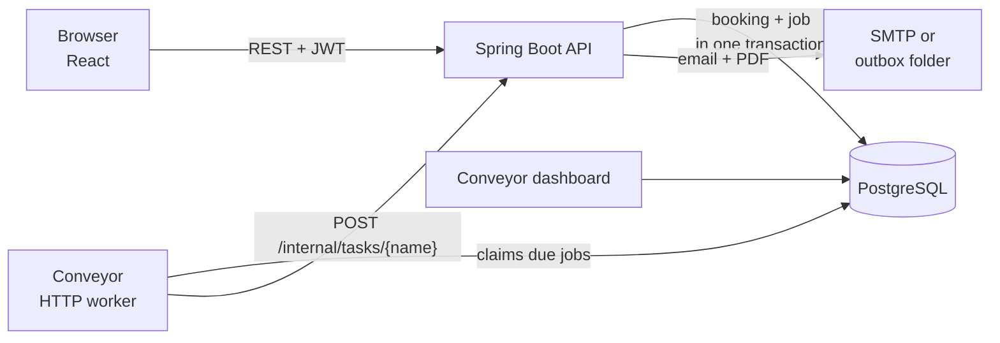
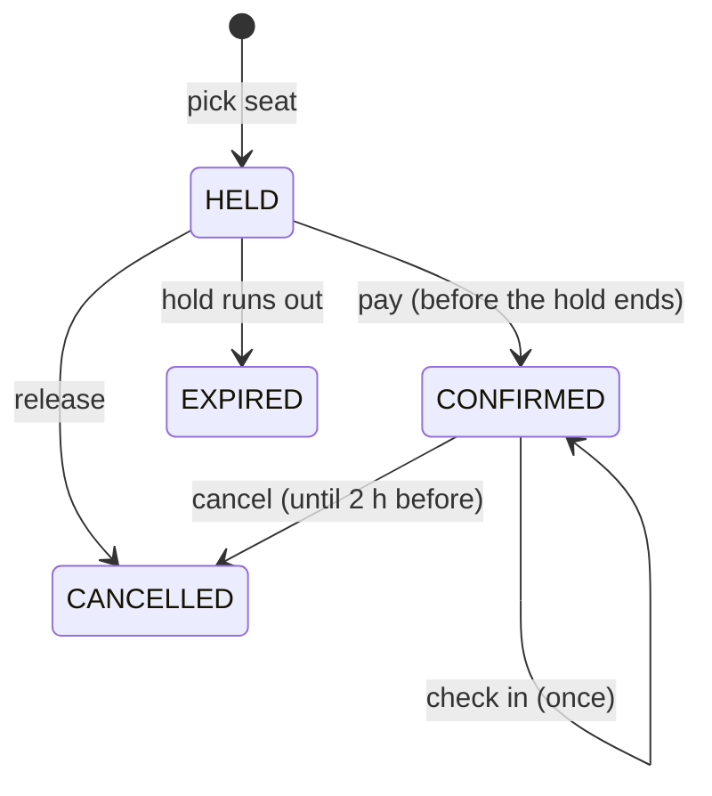

# Ticket Booking

A ticket booking app for events (movies, shows, talks). You pick seats on a live seat map and hold them for 10 minutes while you pay. Your ticket arrives by email as a PDF with a QR code, and a reminder follows 2 hours before the show. You can cancel, join a waitlist when the show is sold out, and staff scan tickets at the door.

**Stack:** Spring Boot 4 (Java 21) · PostgreSQL · React 19 + Vite · [Conveyor](https://github.com/NIKHIOJLK/conveyor) (my PostgreSQL job queue) for everything that happens in the background.

[](https://github.com/NIKHIOJLK/ticket-booking/actions/workflows/ci.yml)

## Features

| | |
|---|---|
| **Seat holds** | Picking a seat holds it for 10 minutes. Nobody else can take it until you pay or the hold runs out. A countdown shows the time left. |
| **No double booking** | Two people clicking the same seat at the same moment: one gets it, the other gets "just taken". The database enforces this, not the Java code. |
| **Mock payment** | Confirming a hold stands in for payment. A hold that ran out can't be confirmed. |
| **Ticket email with PDF** | After paying you get an email with the ticket attached: a PDF with a QR code. |
| **Reminder email** | Sent automatically 2 hours before the event. |
| **My bookings** | Upcoming and past bookings, ticket download, cancel. |
| **Cancellation** | Allowed until 2 hours before the event. The seat goes back on sale and the reminder is called off. |
| **Waitlist** | When an event is sold out you can join its waitlist. When a seat frees up, the person who has waited longest is emailed. |
| **QR check-in** | Admins scan (or type) a ticket reference at the door. Each ticket gets in once. |
| **Admin** | Admins create events with a price and a seat layout. |
| **Limits** | At most 6 seats per person per event. |

## How it works



The API never sends an email or waits for a timer during a request. When something needs to happen later or outside the request, the API adds a **job row in the same database transaction** as the booking change (the *transactional outbox* pattern). So a booking can never exist without its follow-up job, and there's never a job for a booking that was rolled back.

Conveyor's HTTP worker picks up due jobs and calls back into the API at `POST /internal/tasks/{name}` with a shared secret. An answer of `2xx` means done. `5xx` or a timeout means retry with exponential backoff. Other `4xx` answers mean "don't retry". After 8 failed attempts a job goes to the dead-letter list, where the dashboard shows it.

| Task | Added when | Runs | What it does |
|---|---|---|---|
| `expire-hold` | a seat is held | when the hold ends | frees the seat if it still isn't paid for, then asks for `notify-waitlist` |
| `send-ticket-email` | payment confirmed | right away | renders the PDF ticket and emails it |
| `send-reminder` | payment confirmed | 2 h before the event | reminder email (cancelled if the booking is) |
| `send-cancellation-email` | booking cancelled | right away | confirmation of the cancellation |
| `notify-waitlist` | a seat frees up | right away | emails the person first in line |

Conveyor delivers **at least once**: after a timeout a task can run again even though the first attempt actually worked. So every handler first checks whether there is still anything to do. For example, `send-ticket-email` records `ticket_emailed_at` and skips the send if it's already set. Each job also has an idempotency key (`ticket-email:{bookingId}`, `reminder:{bookingId}` and so on), so a double-clicked "Pay" can't add the job twice.

### Booking lifecycle



Every state change is a conditional `UPDATE ... WHERE status = 'HELD'` (compare-and-set). If two requests race, one of them changes 0 rows and loses cleanly, with no locks held across requests. Seats are protected by a partial unique index:

```sql
CREATE UNIQUE INDEX bookings_one_active_per_seat_uidx
    ON bookings (seat_id) WHERE status IN ('HELD', 'CONFIRMED');
```

A seat can have any number of expired or cancelled bookings in its history, but only one live booking. Holds also expire lazily: an expired hold on a seat is cleared the moment someone else asks for that seat, so the seat is free even if the worker is down.

## Run it on Windows

You need PostgreSQL, a JDK 21, Node.js 20 or newer, and Git. Clone this repo and [Conveyor](https://github.com/NIKHIOJLK/conveyor) into the **same folder**:

```
F:\projects\
    conveyor\
    ticket-booking\
```

Then, in PowerShell inside `ticket-booking`:

```powershell
# once: creates backend\.env, backs up your database, runs all tests, builds the frontend
powershell -ExecutionPolicy Bypass -File .\scripts\setup.ps1

# every time: opens backend, worker, dashboard and frontend in their own windows
powershell -ExecutionPolicy Bypass -File .\scripts\start.ps1
```

| What | Where |
|---|---|
| App | http://localhost:5173 |
| Job dashboard (Conveyor) | http://localhost:3000 |
| Emails (outbox mode) | `backend\outbox\` — one folder per email with `email.html` and the PDF |

Accounts whose email is listed in `ADMIN_EMAILS` (in `backend\.env`) become admins and can create events and check people in.

### Manual setup (any OS)

1. Create the databases `ticket_booking` and `ticket_booking_test`.
2. Copy `backend/.env.example` to `backend/.env` and fill it in.
3. Create Conveyor's tables in `ticket_booking`: in `../conveyor` run `npm install`, then `DATABASE_URL=postgres://postgres:<password>@localhost:5432/ticket_booking npm run migrate`.
4. Backend: `cd backend && ./mvnw spring-boot:run`. Flyway creates or updates this app's tables on start.
5. Worker: in `../conveyor`, run `npm run worker:http -- --queues booking-tasks,booking-emails` with `DATABASE_URL` set as above, `TASKS_URL=http://localhost:8080/internal/tasks`, and `TASKS_SECRET` the same as in `backend/.env`.
6. Frontend: `cd frontend && npm install && npm run dev`.

A password with special characters must be URL-encoded in `DATABASE_URL` (`@` becomes `%40`).

### Real emails

`MAIL_MODE=outbox` (the default) saves emails as files. To really send them through Gmail, turn on 2-step verification, create an [app password](https://myaccount.google.com/apppasswords) and set:

```
MAIL_MODE=smtp
SMTP_USERNAME=you@gmail.com
SMTP_PASSWORD=<the 16-letter app password>
MAIL_FROM=Ticket Booking <you@gmail.com>
```

## API

All endpoints except register, login and listing events need `Authorization: Bearer <token>`.

| Method | Path | |
|---|---|---|
| POST | `/api/auth/register` | create an account |
| POST | `/api/auth/login` | returns a JWT |
| GET | `/api/auth/me` | the logged-in user |
| GET | `/api/events` | events with price and free seats |
| GET | `/api/events/{id}` | one event |
| GET | `/api/events/{id}/seats` | seat map: free, held, booked, mine |
| POST | `/api/events` | create an event (admin) |
| POST / DELETE | `/api/events/{id}/waitlist` | join / leave the waitlist |
| POST | `/api/bookings` | hold a seat `{ "seatId": 1 }` |
| POST | `/api/bookings/{id}/confirm` | pay for a hold (410 if it ran out) |
| POST | `/api/bookings/{id}/release` | give a held seat back |
| POST | `/api/bookings/{id}/cancel` | cancel a paid booking |
| GET | `/api/bookings/me` | my bookings |
| GET | `/api/bookings/{id}/ticket.pdf` | download the ticket |
| GET / POST | `/api/checkin/{reference}` | look up / check in a ticket (admin) |
| POST | `/internal/tasks/{name}` | called by Conveyor only (shared secret) |

## Tests

```
cd backend && ./mvnw test
```

Integration tests run the real app on a random port against a real PostgreSQL database (`ticket_booking_test`, wiped before each test). They cover:

- login and roles
- holds, including two users racing for the same seat
- holds running out, payment, cancellation and the 2-hour cutoff
- the seat limit and the waitlist
- check-in
- the background tasks: the right jobs get added, and running them twice is harmless
- the PDF and QR code

CI runs the tests and the frontend lint and build on every push.

## Project layout

```
backend/src/main/java/com/nikhil/ticketbooking/
    controller/   REST endpoints
    service/      booking rules (holds, payment, cancellation, check-in)
    tasks/        TaskQueue (adds Conveyor jobs), TaskController + TaskService (runs them)
    mail/         email templates, SMTP and outbox senders
    tickets/      PDF ticket with QR code
    repository/   Spring Data JPA, including the conditional updates
    security/     JWT filter and helpers
backend/src/main/resources/db/migration/   Flyway SQL migrations
frontend/src/pages/                         React pages
scripts/                                    Windows setup and start scripts
```
